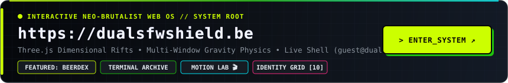

<!-- ===================================================================== -->
<!--            DUALSFWSHIELD // CYBER-SYNTHWAVE COMMAND CENTER            -->
<!-- ===================================================================== -->

<div align="center">

  <!-- LOGO -->
  <a href="https://dualsfwshield.be">
    
  </a>

  <br><br>

  <!-- DYNAMIC TERMINAL TYPING SVG -->
  

  <!-- SOCIAL UPLINKS & LIVE VISITOR TELEMETRY -->
  <p>
    <a href="https://dualsfwshield.be">
      
    </a>
    <a href="https://linkedin.com/in/noah-bruijninckx-930a80221">
      
    </a>
    <a href="https://instagram.com/brn.s00">
      
    </a>
    <a href="https://youtube.com/@Brn-s">
      
    </a>
    <a href="https://github.com/DualsFWShield">
      
    </a>
  </p>

  <!-- CUSTOM ANIMATED CYBER-SYNTHWAVE HUD (Operator Dossier + Live Equalizer) -->
  

  <br><br>

  <!-- DYNAMIC PARODY QUOTE TERMINAL (Auto-updated every 6h via GitHub Actions from quotes.json) -->
  <a href="./quotes.json" title="Click to browse all 100 custom dev parody quotes">
    
  </a>

</div>

---

<!-- ===================================================================== -->
<!--              PORTFOLIO HUB // DUALSFWSHIELD.BE SYSTEM ROOT            -->
<!-- ===================================================================== -->

<h2 align="center">🌐 <code>SYSTEM_ROOT // DUALSFWSHIELD.BE</code></h2>

<div align="center">
  <a href="https://dualsfwshield.be" title="Explore dualsfwshield.be — Interactive Neo-Brutalist Portfolio">
    
  </a>
</div>

---

<!-- ===================================================================== -->
<!--               FLAGSHIP DEPLOYMENTS // FEATURED PROJECTS               -->
<!-- ===================================================================== -->

<h2 align="center">🚀 <code>FLAGSHIP_DEPLOYMENTS // FEATURED_BUILDS</code></h2>

<div align="center">
  <table>
    <tr>
      <td width="50%" valign="top">
        <h3>🍺 <a href="https://beerdex.be">Beerdex</a> &amp; <a href="https://beerpedia.beerdex.be">Beerpedia</a></h3>
        <p>
          
          
          <a href="https://beerdex.be"></a>
        </p>
        <p>
          <b>Le compagnon ultime de tout zythologue.</b> Scannez des codes-barres, débloquez des succès, gérez votre collection, explorez l'encyclopédie brassicole <a href="https://beerpedia.beerdex.be"><b>Beerpedia</b></a> et calculez votre taux d'alcoolémie (BAC) en temps réel. Disponible sur le web et Google Play (<a href="https://github.com/DualsFWShield/beerdex.be"><code>beerdex.be</code></a> / <a href="https://github.com/DualsFWShield/rustdex"><code>rustdex</code></a>).
        </p>
      </td>
      <td width="50%" valign="top">
        <h3>🦀 <a href="https://github.com/DualsFWShield/DFWLogger">DFWLogger</a> &amp; <a href="https://github.com/DualsFWShield/PTZControl">PTZControl</a></h3>
        <p>
          
          
          <a href="https://github.com/DualsFWShield/DFWLogger"></a>
        </p>
        <p>
          <b>Applications systèmes natives écrites en Rust :</b><br>
          • <a href="https://github.com/DualsFWShield/DFWLogger"><b>DFWLogger</b></a> : Superviseur familial &amp; gardien de parc Windows léger et résilient.<br>
          • <a href="https://github.com/DualsFWShield/PTZControl"><b>PTZControl</b></a> : Contrôleur <i>always-on-top</i> haute précision pour caméras PTZ et webcams (presets, focus optique, calibration image).
        </p>
      </td>
    </tr>
    <tr>
      <td width="50%" valign="top">
        <h3>🌌 <a href="https://share.dualsfwshield.be/">AetherShare</a></h3>
        <p>
          
          
          <a href="https://share.dualsfwshield.be/"></a>
        </p>
        <p>
          <b>Serverless Omnishare (<a href="https://github.com/DualsFWShield/share"><code>share</code></a>).</b> Moteur de transfert de données multi-vecteurs (Peer-to-Peer, NFC et Optique) 100% client-side, chiffré de bout en bout (E2EE) et sans aucun serveur backend.
        </p>
      </td>
      <td width="50%" valign="top">
        <h3>🎛️ <a href="https://filetransformer.dualsfwshield.be/">VOID // File Manipulator</a></h3>
        <p>
          
          
          <a href="https://filetransformer.dualsfwshield.be/"></a>
        </p>
        <p>
          <b>Multimedia Manipulation Suite (<a href="https://github.com/DualsFWShield/File-manipulator"><code>File-manipulator</code></a>).</b> Studio créatif <i>offline-first</i> exécuté 100% localement dans le navigateur pour appliquer des effets rétro, glitch et esthétiques sur images, vidéos, textures et audio en temps réel.
        </p>
      </td>
    </tr>
    <tr>
      <td width="50%" valign="top">
        <h3>🌦️ <a href="https://dualsfwshield.github.io/DFWMeteo/">DFWMeteo</a> &amp; 🗺️ <a href="https://dualsfwshield.github.io/DFWMaps/">DFW Suite</a></h3>
        <p>
          <a href="https://dualsfwshield.github.io/DFWMeteo/"></a>
          <a href="https://dualsfwshield.github.io/DFWMaps/"></a>
          <a href="https://dualsfwshield.github.io/DFWDrive/"></a>
        </p>
        <p>
          <b><i>"Twelve skies. One forecast."</i></b> <a href="https://github.com/DualsFWShield/DFWMeteo"><b>DFWMeteo</b></a> fusionne 12 modèles météorologiques numériques (Open-Meteo) en une prévision unifiée et explicable, accompagné de <a href="https://github.com/DualsFWShield/DFWMaps"><b>DFWMaps</b></a>, <a href="https://github.com/DualsFWShield/DFWDrive"><b>DFWDrive</b></a> et <a href="http://dfwatch.dualsfwshield.be/"><b>DFWatch</b></a>.
        </p>
      </td>
      <td width="50%" valign="top">
        <h3>🛡️ <a href="https://dfwcode.dualsfwshield.be/">DFWCode</a>, <a href="https://dualsfwshield.github.io/Image-obfuscator/">Obscurify</a> &amp; Gaming</h3>
        <p>
          <a href="https://dfwcode.dualsfwshield.be/"></a>
          <a href="https://dualsfwshield.github.io/Image-obfuscator/"></a>
          <a href="https://modrinth.com/plugin/dfws-death-swap"></a>
        </p>
        <p>
          • <a href="https://dfwcode.dualsfwshield.be/"><b>DFWCode</b></a> : Générateur de QR codes personnalisés • <a href="https://dualsfwshield.github.io/Image-obfuscator/"><b>Obscurify</b></a> : Obfuscation d'images<br>
          • <a href="http://updown.dualsfwshield.be/"><b>UpDown</b></a> : Arbitrage &amp; scores de cartes avec export PDF • <a href="https://dualsfwshield.github.io/DFWS-Chess/"><b>DFWS-Chess</b></a> : Échecs &amp; IA<br>
          • <a href="https://spotify.dualsfwshield.be/"><b>Spotify Wrapped Analyzer</b></a> • <a href="https://profiler.dualsfwshield.be/"><b>The Profiler</b></a> • <a href="https://github.com/DualsFWShield/DeathSwap"><b>DeathSwap</b></a> (Plugin Paper 1.21)
        </p>
      </td>
    </tr>
  </table>
</div>

---

<!-- ===================================================================== -->
<!--                 MISSION CONTROL & CONTRIBUTION SNAKE                  -->
<!-- ===================================================================== -->

<div align="center">
  <table>
    <tr>
      <td valign="center" width="46%">
        <h3><code>&gt;_ whoami --mission-brief</code></h3>
        <p>
          🦀 <b>Systems &amp; Web:</b> Rust Native Apps &amp; Local-First Web Architecture<br><br>
          🛡️ <b>Cyber &amp; Privacy:</b> Ethical Hacking, E2EE &amp; Client-Side Security<br><br>
          🤖 <b>Core R&amp;D:</b> Artificial Intelligence, LLM Agents &amp; Automation<br><br>
          🎬 <b>Motion Lab:</b> Video Editing, 3D Blender &amp; Visual Identity<br><br>
          ⚡ <b>Fun Fact:</b> <i>I code 10x better with synthwave &amp; phonk on loop</i>
        </p>
      </td>
      <td valign="center" width="54%">
        <h3 align="center"><code>&gt;_ contribution_matrix.snk</code></h3>
        <picture>
          <source media="(prefers-color-scheme: dark)" srcset="https://raw.githubusercontent.com/DualsFWShield/DualsFWShield/output/github-contribution-grid-snake-dark.svg" />
          <source media="(prefers-color-scheme: light)" srcset="https://raw.githubusercontent.com/DualsFWShield/DualsFWShield/output/github-contribution-grid-snake.svg" />
          
        </picture>
      </td>
    </tr>
  </table>
</div>

---

<!-- ===================================================================== -->
<!--                   4-QUADRANT CYBER ARSENAL (TECH STACK)               -->
<!-- ===================================================================== -->

<h2 align="center">⚡ <code>TECH_ARSENAL // LOADOUT</code></h2>

<div align="center">
  <table>
    <tr>
      <td align="center" width="50%" valign="top">
        <h4><code>[01] // CORE_LANGUAGES</code></h4>
        <p>
          
          
          
          
          
        </p>
      </td>
      <td align="center" width="50%" valign="top">
        <h4><code>[02] // FRAMEWORKS_&_AI_ENGINE</code></h4>
        <p>
          
          
          
          
          
          
        </p>
      </td>
    </tr>
    <tr>
      <td align="center" width="50%" valign="top">
        <h4><code>[03] // CLOUD_DB_&_INFRA</code></h4>
        <p>
          
          
          
          
          
        </p>
      </td>
      <td align="center" width="50%" valign="top">
        <h4><code>[04] // CREATIVE_&_3D_STUDIO</code></h4>
        <p>
          
          
          
          
        </p>
      </td>
    </tr>
  </table>
</div>

---

<!-- ===================================================================== -->
<!--                      TELEMETRY & GITHUB ANALYTICS                     -->
<!-- ===================================================================== -->

<h2 align="center">📊 <code>SYSTEM_TELEMETRY // GITHUB_STATS</code></h2>

<div align="center">
  <table align="center">
    <tr>
      <td align="center">
        
      </td>
      <td align="center">
        
      </td>
    </tr>
  </table>

  
</div>

---

<!-- ===================================================================== -->
<!--                 INTERACTIVE EASTER EGG // SOURCE PROTOCOL             -->
<!-- ===================================================================== -->

<div align="center">
  <details>
    <summary><b><code>[ + ] DECRYPT_CLASSIFIED_PROTOCOL // DUALSFWSHIELD.RS</code></b></summary>
    <br>
    <div align="left">

```rust
pub struct CyberOperator {
    pub handle: &'static str,
    pub host: &'static str,
    pub stack: [&'static str; 5],
    pub flagship_builds: [&'static str; 6],
    pub soundtrack: &'static str,
}

pub const NOAH: CyberOperator = CyberOperator {
    handle: "DualsFWShield",
    host: "https://dualsfwshield.be",
    stack: ["Rust", "JavaScript", "HTML5/CSS3", "Vue.js", "Bash"],
    flagship_builds: ["Beerdex", "DFWLogger", "PTZControl", "AetherShare", "VOID", "DFWMeteo"],
    soundtrack: "Synthwave & Phonk // 128 BPM",
};
```

  </div>
  <p align="center">
    <sub>💡 <i>Tip: The terminal quote at the top rotates automatically every 6 hours from <a href="./quotes.json"><code>quotes.json</code></a> (100 custom pop-culture &amp; historical dev parodies) via GitHub Actions.</i></sub>
  </p>
  </details>
</div>
