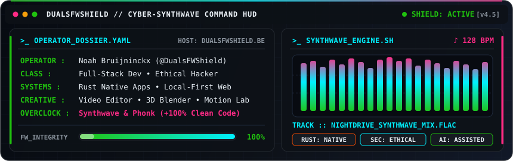

<!-- ===================================================================== -->
<!--            DUALSFWSHIELD // CYBER-SYNTHWAVE COMMAND CENTER            -->
<!-- ===================================================================== -->

<div align="center">

  <!-- LOGO -->
  <a href="https://github.com/DualsFWShield">
    
  </a>

  <br><br>

  <!-- DYNAMIC TERMINAL TYPING SVG -->
  

  <!-- SOCIAL UPLINKS & VISITOR TELEMETRY -->
  <p>
    <a href="https://sites.google.com/view/brn-s/">
      
    </a>
    <a href="https://linkedin.com/in/noah-bruijninckx-930a80221">
      
    </a>
    <a href="https://instagram.com/brn.s00">
      
    </a>
    <a href="https://youtube.com/@Brn-s">
      
    </a>
    <a href="https://github.com/DualsFWShield">
      
    </a>
  </p>

  <!-- CUSTOM ANIMATED CYBER-SYNTHWAVE HUD (Operator Dossier + Live Equalizer) -->
  

  <br><br>

  <!-- DYNAMIC PARODY QUOTE TERMINAL (Auto-updated every 6h via GitHub Actions from quotes.json) -->
  <a href="./quotes.json" title="Click to browse all 100 custom dev parody quotes">
    
  </a>

</div>

---

<!-- ===================================================================== -->
<!--                 MISSION CONTROL & CONTRIBUTION SNAKE                  -->
<!-- ===================================================================== -->

<div align="center">
  <table>
    <tr>
      <td valign="center" width="46%">
        <h3><code>&gt;_ whoami --mission-brief</code></h3>
        <p>
          🔭 <b>Active Build:</b> Advanced HTML, Full-Stack &amp; Web Architecture<br><br>
          🛡️ <b>Skill Tree:</b> Python, PHP &amp; Offensive/Defensive Cyber Security<br><br>
          🤖 <b>Core R&amp;D:</b> Artificial Intelligence, LLM Agents &amp; Automation<br><br>
          🎬 <b>Creative Lab:</b> Video Editing, 3D Modeling &amp; Visual Design<br><br>
          ⚡ <b>Fun Fact:</b> <i>I code 10x better with synthwave music on loop</i>
        </p>
      </td>
      <td valign="center" width="54%">
        <h3 align="center"><code>&gt;_ contribution_matrix.snk</code></h3>
        <picture>
          <source media="(prefers-color-scheme: dark)" srcset="https://raw.githubusercontent.com/DualsFWShield/DualsFWShield/output/github-contribution-grid-snake-dark.svg" />
          <source media="(prefers-color-scheme: light)" srcset="https://raw.githubusercontent.com/DualsFWShield/DualsFWShield/output/github-contribution-grid-snake.svg" />
          
        </picture>
      </td>
    </tr>
  </table>
</div>

---

<!-- ===================================================================== -->
<!--                   4-QUADRANT CYBER ARSENAL (TECH STACK)               -->
<!-- ===================================================================== -->

<h2 align="center">⚡ <code>TECH_ARSENAL // LOADOUT</code></h2>

<div align="center">
  <table>
    <tr>
      <td align="center" width="50%" valign="top">
        <h4><code>[01] // CORE_LANGUAGES</code></h4>
        <p>
          
          
          
          
          
          
        </p>
      </td>
      <td align="center" width="50%" valign="top">
        <h4><code>[02] // FRAMEWORKS_&_AI_ENGINE</code></h4>
        <p>
          
          
          
          
          
          
        </p>
      </td>
    </tr>
    <tr>
      <td align="center" width="50%" valign="top">
        <h4><code>[03] // CLOUD_DB_&_INFRA</code></h4>
        <p>
          
          
          
          
          
        </p>
      </td>
      <td align="center" width="50%" valign="top">
        <h4><code>[04] // CREATIVE_&_3D_STUDIO</code></h4>
        <p>
          
          
          
          
        </p>
      </td>
    </tr>
  </table>
</div>

---

<!-- ===================================================================== -->
<!--                      TELEMETRY & GITHUB ANALYTICS                     -->
<!-- ===================================================================== -->

<h2 align="center">📊 <code>SYSTEM_TELEMETRY // GITHUB_STATS</code></h2>

<div align="center">
  <table align="center">
    <tr>
      <td align="center">
        
      </td>
      <td align="center">
        
      </td>
    </tr>
  </table>

  
</div>

---

<!-- ===================================================================== -->
<!--                 INTERACTIVE EASTER EGG // SOURCE PROTOCOL             -->
<!-- ===================================================================== -->

<div align="center">
  <details>
    <summary><b><code>[ + ] DECRYPT_CLASSIFIED_PROTOCOL // DUALSFWSHIELD.TS</code></b></summary>
    <br>
    <div align="left">

```typescript
interface CyberOperator {
  readonly handle: "DualsFWShield";
  readonly alias: "Noah";
  readonly roles: ["Full-Stack Dev", "Ethical Hacker", "Video Editor", "AI Enthusiast"];
  readonly stack: ["Python", "JavaScript", "PHP", "Vue.js", "Node.js", "PyTorch", "TensorFlow"];
  readonly soundtrack: "Synthwave // 128 BPM";
  readonly quotePoolSize: 100; // Auto-rotated every 6h from ./quotes.json
}

const executeNightDrive = async (operator: CyberOperator): Promise<void> => {
  while (operator.handle === "DualsFWShield") {
    await playSynthwave();
    await buildCleanArchitecture();
    await auditSecurityPerimeter();
    await trainNeuralModels();
  }
};
```

  </div>
  <p align="center">
    <sub>💡 <i>Tip: The terminal quote at the top rotates automatically every 6 hours from <a href="./quotes.json"><code>quotes.json</code></a> (100 custom pop-culture &amp; historical dev parodies) via GitHub Actions.</i></sub>
  </p>
  </details>
</div>
